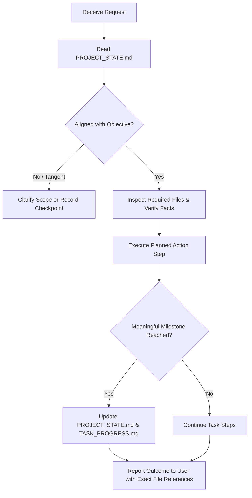

# AI Agent Operating Guidelines & Rules (AGENTS.md)
**Project**: Shree Ashirwad Packers and Movers (`shreeashirwadpackers`)  
**Scope**: Permanent behavioral rules and operating protocol for all AI assistants, agents, and subagents.

---

## 1. Core Operating Principles

### A. Strict Focus & Anti-Drift
1. **Stick to the Active Task**: Never broaden scope or take initiative on unrelated files, features, or architectural overhauls unless the user explicitly requests it.
2. **Anti-Drift Verification**: Before taking major actions, verify that the action directly serves the `Current Objective` recorded in [`PROJECT_STATE.md`](file:///d:/shreeashirwadpackers/PROJECT_STATE.md).
3. **Handle Topic Switches Deliberately**: If the user raises an unrelated question or request during an active task:
   - Clarify whether this is an ad-hoc informational question or an intentional task switch.
   - If switching tasks, record the checkpoint of the current task in [`PROJECT_STATE.md`](file:///d:/shreeashirwadpackers/PROJECT_STATE.md) first before transitioning.

### B. Verify Before Concluding (Zero Assumptions)
1. **Never Assume**: Never speculate about file contents, server configuration, database state, routing rules, or previous user actions. Always inspect the source directly with read tools.
2. **Explicit Fact vs. Assumption Separation**:
   - **Verified Fact**: Information confirmed by reading actual file lines, tool outputs, or Git logs (must reference the exact file and line number).
   - **Assumption / Hypothesis**: Any inferred or unverified belief. Must be explicitly tagged `[ASSUMPTION - PENDING VERIFICATION]` and verified before any action is taken.
3. **Ask When Information Is Missing**: If a required credential, business rule, or specification is absent, stop and ask the user rather than guessing or inventing placeholders.

### C. Persistent Memory & State Continuity
1. **Mandatory Start/Resume Check**:
   - Before answering or starting work on a non-trivial request, always read [`PROJECT_STATE.md`](file:///d:/shreeashirwadpackers/PROJECT_STATE.md).
   - Check what work is already marked `Completed`, what is `Pending`, what files have already been inspected, and what `Next Action` was scheduled.
2. **Do Not Repeat Completed Work**: Do not re-inspect, re-test, or re-write solutions for tasks marked completed in [`PROJECT_STATE.md`](file:///d:/shreeashirwadpackers/PROJECT_STATE.md) or [`TASK_PROGRESS.md`](file:///d:/shreeashirwadpackers/TASK_PROGRESS.md) unless explicitly asked to re-verify.
3. **Respect Past Decisions**: All architectural, structural, and procedural decisions logged in the "Important Decisions" section of [`PROJECT_STATE.md`](file:///d:/shreeashirwadpackers/PROJECT_STATE.md) are binding. Do not silently reverse or alter past decisions.

### D. Milestone-Based Progress Tracking
1. **Meaningful Milestone Updates**: For multi-step or long-running tasks, update [`TASK_PROGRESS.md`](file:///d:/shreeashirwadpackers/TASK_PROGRESS.md) and [`PROJECT_STATE.md`](file:///d:/shreeashirwadpackers/PROJECT_STATE.md) at meaningful milestones (e.g., phase completion, blocker discovered, transition to new phase)—**never** after every micro-action or single tool call.
2. **Clean State Handoff**: At the conclusion of every milestone or task, leave [`PROJECT_STATE.md`](file:///d:/shreeashirwadpackers/PROJECT_STATE.md) in a clean, unambiguous state so that a subsequent session or compacted conversation can resume without loss of context.

---

## 2. Production & Code Safety Boundaries

Unless a user prompt explicitly commands code modification for a specific task:
1. **Do NOT modify** production PHP templates (`pages/`, `includes/`, `router.php`, `index.php`).
2. **Do NOT modify** web server configurations (`.htaccess`, `robots.txt`).
3. **Do NOT touch** dependencies, package files, or credentials (`service_account.json`, `.env`).
4. **Do NOT rename, delete, or rewrite** existing assets, database dumps, or audit documents (`problem/`, `data/`).
5. **Keep Agent Infrastructure Isolated**: All persistent agent context files (`AGENTS.md`, `PROJECT_STATE.md`, `TASK_PROGRESS.md`, `.agents/`) must remain completely decoupled from website runtime code.
6. **Brand & CSS Scope Protection**: NEVER override global CSS variables (`--primary`, `--primary-dark`, `--accent`) or tag-level `body` styles that alter or corrupt global `header.php` and `footer.php` colors. Header and footer styling must remain 100% consistent across every page.
7. **Mobile UX Standard**: NEVER insert two-column sidebar wrappers, floating widgets, or desktop-only aside elements that break responsive mobile rendering. All pages must use responsive full-width containers.
8. **Full HTML Document Shell Standard**: Every PHP page in `pages/` MUST be a complete HTML document with `<!DOCTYPE html>`, `<head>`, `<link rel="stylesheet" href="<?php echo SITE_BASE_URL; ?>/assets/css/style.css">`, `<body>`, `header.php`, `footer.php`, and `</body></html>`. `header.php` and `footer.php` are markup partials; never omit the outer document shell or the core stylesheet link.
9. **Mandatory In-Body Internal Linking Standard**: Every service, corridor, city hub, or neighborhood page in `pages/` MUST contain contextual, in-body internal links built directly into the page markup at creation time (never retrofitted as an afterthought):
   - **Pillar / Hub Link**: At least 1 contextual link to the parent city authority page (e.g. `packers-and-movers-in-[city]`) or the company HQ authority page (`packers-and-movers-in-ranchi`).
   - **Live Tariff Calculator Link**: In-text link within pricing sections pointing to `/packers-and-movers-charges-in-ranchi`.
   - **Return Pair Link (for Directional Corridors)**: Directional routes (City A to City B) must link directly to their exact reciprocal return route (City B to City A).
   - **Connected Cluster Module**: A dedicated, responsive cluster module with 4 to 8 valid internal links to thematically relevant routes or sister neighborhood hubs using descriptive anchor text.
   - **Zero Dead Ends & Zero Broken Links**: No page may be left with 0 in-body internal links. All target slugs MUST exist in `pages/` or `PAN_INDIA_HUB_PAGE_PROGRESS.md` (zero broken links).
10. **Pan-India Hub & Hyper-Local Execution Standard**: All non-Jharkhand expansion pages must adhere strictly to `PAN_INDIA_HUB_PAGE_PROGRESS.md` and `AI_PAGE_CREATION_RULES.md`:
    - **50-Page Non-Stop Handcrafting Execution**: When page creation commences, execute a batch of **50 pages in one go as planned**, continuing continuously without premature stopping or pausing. Only stop and present the comprehensive progress report after completing the full 50-page target.
    - **Handcrafted Quality (Zero Automation / No Scripts)**: Never run generator bots, scrapers, automated scripts, or bulk templating tools to generate or write page content. Each of the 50 pages must be individually handcrafted with rich, authentic local detail.
    - **Word Count & Content Depth**: Minimum 1,600 visible words (target 1,700–2,100) with authentic, localized geographic, residential, and industrial details.
    - **Schema & Visual Compliance**: Exactly 4 valid JSON-LD schemas (`MovingCompany`, `BreadcrumbList`, `Service`, `FAQPage`) and 4 verified image assets (`max-width: 680px; margin: 28px auto;`).
    - **Pre-Publish Verification**: Verify 0 PHP errors (`php -l`), 100% HTTP 200 OK on local web server, and check off the item in `PAN_INDIA_HUB_PAGE_PROGRESS.md`.
11. **Mandatory Scoped CSS Class Parity & Image Dimension Containment Standard**:
    - **100% Class Prefix Parity**: When utilizing scoped CSS prefixes (e.g. `[pfx]-wrap`, `[pfx]-section`, `[pfx]-image-container`, `[pfx]-table`, `[pfx]-grid-2`), the prefix declared in the page's `<style>` block must match 100% of the class names in the `<body>` markup. Partial find-and-replace, remnant classes from donor templates (e.g., `rkz-` on a `kzr-` page, `adi-kol-` on an `adi-pat-` page), and orphaned classes are strictly prohibited.
    - **Image Dimension Containment**: All images MUST reside inside an explicitly dimension-constrained container (`max-width: 580px; margin: 0 auto; overflow: hidden; border-radius: 12px;` or `aspect-ratio: 4/3` / `16/9` / `3/4`). Never leave raw `` tags in unconstrained block containers that allow vertical/portrait photos to expand to full container width.
    - **Pre-Publish Layout Parity Verification**: Every page must undergo verification ensuring zero orphaned/unmatched classes, styled table borders/headers, and responsive image containment without vertical blowing-up or layout collapse.
12. **Mandatory Physical Image Existence Verification Standard**:
    - **Physical Disk Existence Required**: Never guess, invent, or use approximate image file names. Every `` `src` and JSON-LD Schema `image` URL MUST correspond to an existing physical file on disk in `images/` or `assets/images/`.
    - **Automated Verification**: Before publishing, every page must be verified with an automated tool (such as `scratch/validate_page.py`) ensuring zero 404/broken image references.
13. **Content Chunking & Visual Balance Standard**:
    - **No Walls of Text**: Monotonous walls of text (more than 2 to 3 consecutive `
` paragraphs in a single block) are strictly prohibited.
    - **Micro-Elements & Visual Breaks**: Break up long descriptions with stylized bullet highlight boxes (`<ul>` with custom styling), micro-metric cards, 2x2 capability grids, or subheadings.
    - **Column Height Balance**: In 2-column grid layouts (such as Section 1), the text column and visual column must maintain visual balance. Complement images with key takeaway cards, service guarantee boxes, or secondary visual media to avoid massive empty white spaces.
14. **Mandatory Meta Keywords Tag Standard**:
    - Every page `<head>` block MUST explicitly include a comprehensive, comma-separated `<meta name="keywords" content="...">` tag directly beneath the `<meta name="description">` tag.
    - The keywords must be hyper-localized to the target area (e.g. packers and movers in [Locality] [City], household shifting, office relocation, cost, best moving company in [Locality]). Never omit this tag.
15. **Mandatory Concurrent Quint-Chat Operating & Territory Partition Standard**:
    - **Exclusive Territorial Ownership**: When multiple chat sessions operate simultaneously, each session is strictly bound to its assigned territory to eliminate race conditions, duplicate effort, and file collisions:
      - **Chat 1 (`3e493272-ffad-4c5b-a2ab-e8a45f211ac5`)**: Exclusively owns Northern States (Punjab, Chandigarh, Uttarakhand, Himachal Pradesh, Jammu & Kashmir).
      - **Chat 2 (`e4c5c124-07a7-4a91-bbfb-c5653cac8485`)**: Exclusively owns Western Hubs &mdash; Gujarat (45 Hubs: 20 Cities + 25 Hyper-Local Localities).
      - **Chat 3 (`b13ca1a9-481b-40bb-91ae-ca7c5c084375`)**: Exclusively owns Central Hubs &mdash; Madhya Pradesh (47 Hubs: 22 Cities + 25 Hyper-Local Localities).
      - **Chat 4 (`96b67ba7-1cb0-42d2-b5c0-4375d41ecff1`)**: Exclusively owns Western Hubs &mdash; Rajasthan (36 Hubs: 16 Cities + 20 Hyper-Local Localities).
      - **Chat 5 (`33bf0d35-19c3-455f-9f94-eb6efcb590e0`)**: Exclusively owns Central Hubs &mdash; Chhattisgarh (30 Hubs: 12 Cities + 18 Hyper-Local Localities).
    - **Strict Non-Interference**: No chat session may touch, overwrite, or edit pages belonging to the other chats' assigned territories.
    - **Cumulative Progress Ledger**: All chats record progress cleanly in `PAN_INDIA_HUB_PAGE_PROGRESS.md` without overwriting the other chats' checkmarks.
16. **Mandatory Concurrent Dual-Chat Operating & Blog Partition Standard**:
    - **Exclusive Territorial Ownership**: When multiple chat sessions work concurrently on the 49 Blog & Relocation Guide Network (`BLOG_PAGE_PROGRESS.md`):
      - **Blog Chat 1 (`416a1c4e-d6e6-4fbe-be42-02c7f75ec210`)**: Exclusively owns **Pages 1 to 29** (Clusters 1, 2, 3, 4, and initial Cluster 5: `pages/home-shifting-checklist-ranchi.php` through `pages/schools-around-ranchi.php`). Blog Chat 1 MUST NOT create, touch, or overwrite Pages 30 to 49.
      - **Blog Chat 2 (`3b858c70-6d7a-48bd-ad3a-3bc965e8ddf3` - Current Chat)**: Exclusively owns **Pages 30 to 49** (20 Pages: State/District Guides 30–32, plus all Long-Distance Corridors 33–49: `pages/jharkhand-tourism-famous-places-guide.php` through `pages/ranchi-to-ahmedabad-relocation-guide.php`). Blog Chat 2 MUST NOT create, touch, or overwrite Pages 1 to 29.
    - **Strict Non-Interference & Zero Overwrite**: Neither session shall touch, overwrite, or edit the other session's assigned pages or ledger checkmarks in `BLOG_PAGE_PROGRESS.md`.

---

## 3. Standard Task Execution Flow

Every task must adhere to the following sequence:

---

## 4. Reference to Skills
For detailed protocols on recovering context, handling conversation compaction, and updating state files, activate and refer to the workspace skill:
- [`.agents/skills/task-continuity/SKILL.md`](file:///d:/shreeashirwadpackers/.agents/skills/task-continuity/SKILL.md)
